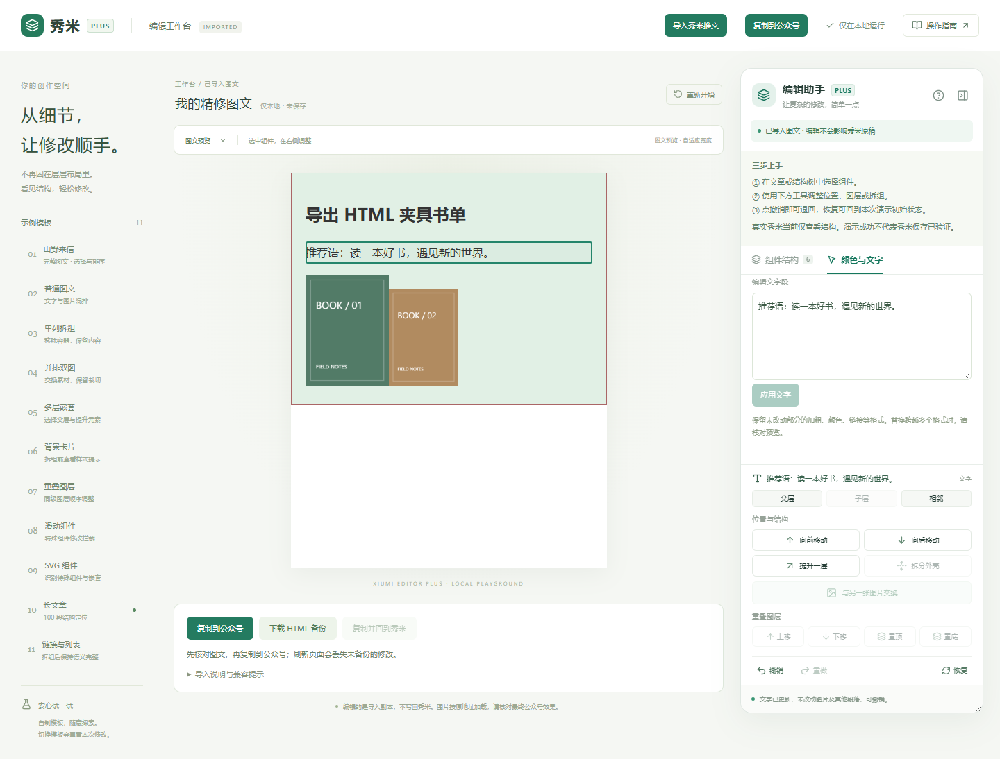

# 秀米编辑增强助手 · Xiumi Editor Plus

**看清组件结构，让复杂的修改简单一点。** 一个使用 WXT、React 与 TypeScript 构建的 Chrome / Edge 扩展。

> **0.3.0 实验版：增加背景板识别、独立调色板和段落编辑。真实页仅作结构检查，已过滤页面外壳和隐藏副本；原生选中联动因实测选区错误而暂停。复制并返回来源标签不等于自动导入或保存。公众号最终效果需预览验证。** 本项目为独立社区项目，与秀米官方无隶属关系。


## 开始使用

1. 在 [Releases](https://github.com/Eureka-Y17/xiumi-editor-plus/releases) 下载实验版 ZIP 并解压。
2. Chrome 打开 `chrome://extensions`；Edge 打开 `edge://extensions`。
3. 打开「开发者模式」，选择「加载已解压的扩展程序」，选择解压后包含 `manifest.json` 的目录。
4. 在秀米点击「导出」，按提示 Ctrl+C。打开助手的「导入推文精修」工作台，在粘贴区域 Ctrl+V。
5. 核对预览，在结构树里整理普通图片或布局，完成后点击「复制到公众号」，到公众号正文编辑器 Ctrl+V；先保存草稿并检查手机预览。
6. 可随时「下载 HTML 备份」。关闭或刷新工作台会丢失未备份修改；秀米原稿不受影响。无需配置接口或关联官方插件。

详细步骤见 [中文操作手册](docs/USER_GUIDE.md)。

## 本版可以体验什么

- 浅色中文工作台、可折叠与调宽面板、Shadow DOM 样式隔离。
- 组件树与文章双向选择，父层、子层及相邻组件导航。
- 识别纯色、渐变及图片背景；选中节点调整底色、文字色和边框色，编辑独立文字段。
- 过滤秀米活动页外壳、空容器与隐藏副本；本地精修后可复制并返回来源标签，手动粘贴。
- 图片交换素材但保留位置尺寸、裁切和布局；同级排序与拖动。
- 普通单列拆组、内容提升一层、同级重叠顺序调整。
- 拆组前提示样式损失；最多 40 步撤销 / 重做及初始状态恢复。
- 11 个自制模板；SVG、滑动和特殊结构修改拦截。

编辑能力开放于自制演示及导入副本。导入保留可用 HTML 的嵌套、内联样式和图片；普通单列布局自动识别，复杂 SVG/媒体相关结构仍只读。它不是秀米原生组件模型；图片是否为合成图也不能自动判断。

真实页若只显示两个文字节点，旧版可能误把局部文字框当成全文。新版查找更完整的候选区域，并提供「点选文章范围」「扩大一层」「重新识别」。要精修整篇推文，优先使用导出粘贴流程。

## 开发

推荐 Node.js 24 LTS 最新补丁版及 npm。

```sh
npm ci
npm run dev
```

生产构建与测试：

```sh
npm run typecheck
npm test
npm run build
npx playwright install chromium
npm run test:e2e
npm run zip
```

构建目录为 `.output/chrome-mv3`，可在 Chrome 或 Edge 中加载。ZIP 位于 `.output/`。演示页面为扩展内置 `demo.html`，从扩展弹窗打开。

## 文档与状态

- [第一版开发报告](docs/DEVELOPMENT_REPORT.md)：痛点、架构、范围和技术关卡。
- [操作说明与故障排查](docs/USER_GUIDE.md)
- [测试记录与兼容范围](docs/TEST_REPORT.md)
- [公开前端分析记录](docs/FRONTEND_RESEARCH.md)
- [简明开发接口](docs/INTEGRATION.md)
- [贡献指南](CONTRIBUTING.md) / [更新记录](CHANGELOG.md) / [隐私说明](PRIVACY.md)

当前没有后端、遥测或文章上传；导入仅在用户粘贴时读取富文本，复制仅在用户点击时执行。远程图片会按原地址加载。扩展仅在 HTTPS 秀米域名注入，不申请所有网站权限。演示图片为项目内生成的 SVG 数据图片。



## 后续方向

先验证原生编辑命令与文档模型，再逐个开放真实编辑能力。每项都需要「修改 → 撤销 → 保存 → 刷新 → 公众号预览」证据；不能以 DOM 外观变化代替保存验证。

开源协议：[MIT](LICENSE)。第三方依赖保留各自许可，参见 [第三方说明](THIRD_PARTY_NOTICES.md)。
