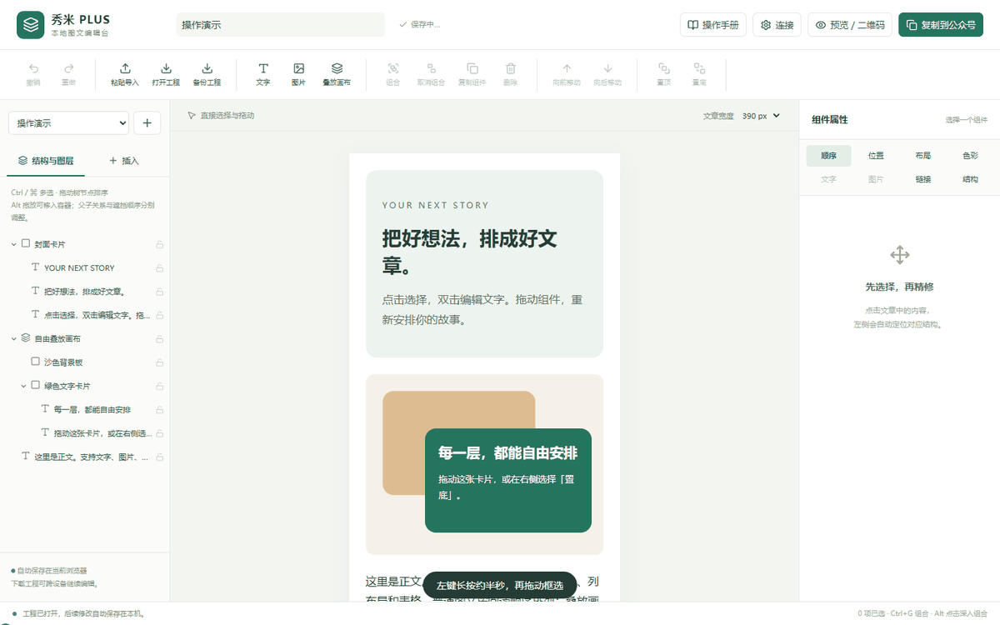
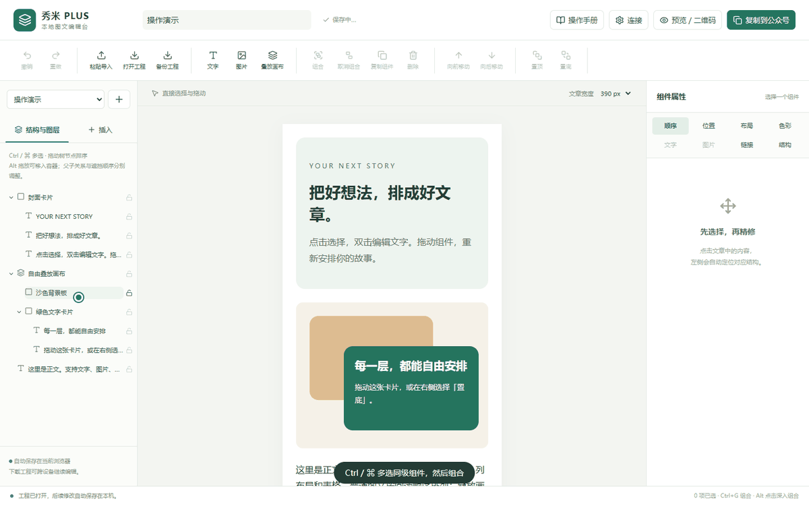
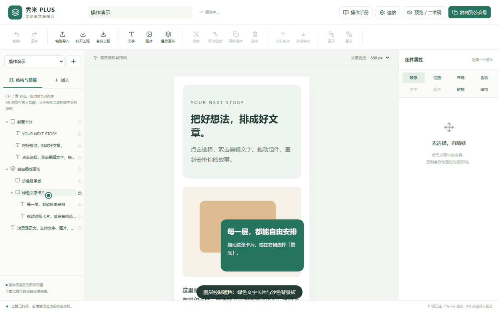
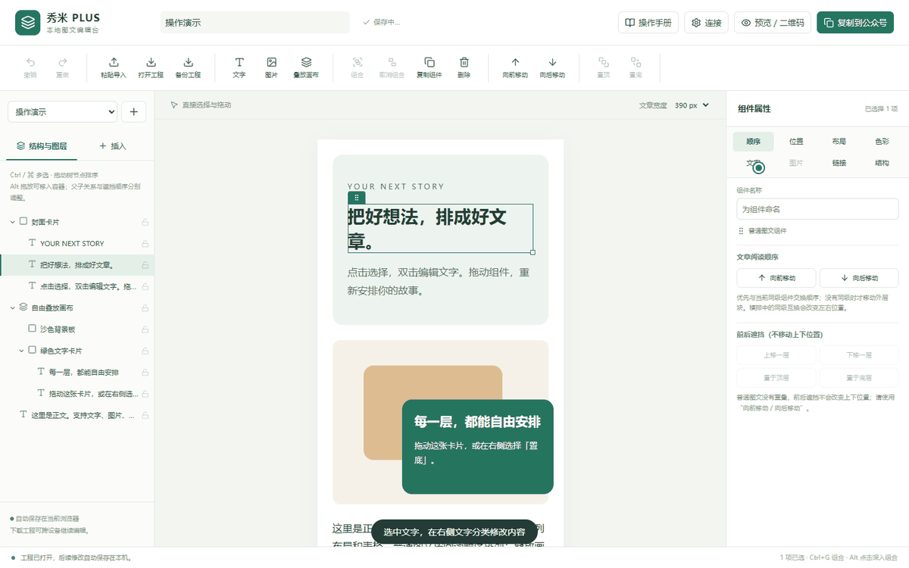

# 秀米 PLUS · 本地图文编辑台

**让公众号图文更容易选、更容易改、更容易移动。**

秀米 PLUS 是一款 Chrome / Edge 浏览器扩展。你可以把秀米导出的图文粘贴进独立工作台，精修文字、图片、背景与布局，再复制到公众号后台。适合复杂模板选不中、嵌套组件难调整，以及希望把多个组件组合移动的编辑者。

[下载安装](https://github.com/Eureka-Y17/xiumi-editor-plus/releases) · [操作手册](docs/USER_GUIDE.md) · [版本更新](CHANGELOG.md) · [问题反馈](https://github.com/Eureka-Y17/xiumi-editor-plus/issues)


## 三分钟开始

1. 在 [发布页](https://github.com/Eureka-Y17/xiumi-editor-plus/releases) 下载 **chrome.zip**，解压到固定文件夹。
2. 打开 `chrome://extensions` 或 `edge://extensions`，开启开发者模式 →「加载已解压的扩展程序」，选择包含 `manifest.json` 的文件夹。
3. 点击扩展图标 →「打开精修工作台」。直接使用自制示例练习，或从秀米「导出」页复制全文，再点「粘贴导入」。
4. 编辑完成后点「复制到公众号」，粘贴进公众号后台并检查效果。顶部「操作手册」提供详细步骤和可播放、暂停的操作动图。

**普通编辑不需要注册账号、启动服务或配置公众号密钥。** 草稿自动保存在当前浏览器；重要文章请点击「备份工程」下载 `.xep.json`。

## 可以做什么

### 选中你真正想改的组件

- 正文与结构树联动，点击正文自动展开并滚动到对应节点；可选择父层和子层。
- **左键长按约半秒，再拖动框选**：完整框住父组件时只取最大层；只框住内部几项时选择这些子项。
- Ctrl / ⌘ / Shift 多选，反向框选、追加框选、Esc 取消；锁定与解锁组件。



### 调整顺序，组合移动，控制遮挡

- 正文直接拖拽和结构树拖放排序，同级组件向前 / 向后移动；Alt 拖放移入允许的容器。
- 同级组件组合、取消组合，普通单列外壳拆分与内容提升。
- 自由叠放画布支持文字、图片、背景板和组合的坐标拖动、缩放、置顶、置底与逐层调整。
- 组件位置尺寸、水平对齐、画布内垂直对齐、旋转与透明度；父子结构和遮挡顺序分别处理。
- 复制、删除、重命名、撤销和重做；Ctrl / ⌘ + Z 可撤销文章操作。

<details>
<summary>观看组合与图层操作</summary>





</details>

### 精修文字、图片与排版

- 段落内容编辑、选区富文本、加粗、斜体、下划线、删除线、文字色及 HTTPS 链接。
- 字体、字号、行高、字间距、缩进和段落对齐。字体能否显示取决于阅读设备安装的字体。
- 背景、文字和边框调色，经典八色、系统色盘、颜色值、圆角、边框与内外边距。
- 本地图片插入和替换、显示与裁切；标题、正文、引用、列表、分隔线、卡片、列布局与表格文字。
- 在完整文章块前后插入空行；普通插入沿文章上下排版，画布内插入使用独立入口。
- 右侧按顺序、位置、布局、色彩、文字、图片、链接、结构分类，文字内容与排版分开操作。

<details>
<summary>观看文字编辑</summary>



</details>

### 保存、预览与交付

- 本地草稿库、自动保存、工程导入导出；工程保留组合与画布结构，方便继续编辑。
- 电脑预览、HTML 下载、打印 / PDF、富文本复制到公众号后台。
- 可选本机服务：同一 Wi-Fi 手机二维码预览、撤销预览，以及公众号官方接口新建草稿。
- 自由叠放及图片背景区域在交付副本中合成图片以保留外观；本地工程仍可分层编辑。

## 手机二维码：第一次怎么连接

手机需要一个可以访问的网页地址。扩展内部页面只能在电脑浏览器中打开，因此手机预览使用你电脑上运行的小服务。

1. 从 [发布页](https://github.com/Eureka-Y17/xiumi-editor-plus/releases) 下载与扩展同版本的 **local-service.zip**，完整解压。
2. 安装 [Node.js 24 或更新版本](https://nodejs.org/)，双击服务文件夹内的 **start-preview.cmd**。首次启动会联网准备依赖，等待窗口显示配对码。
3. 保持服务窗口打开，在编辑台「连接」中粘贴配对码，点「连接本地服务」，允许浏览器申请的本机访问权限。
4. 手机和电脑连接同一 Wi-Fi，切换「手机预览」，选择局域网地址，再生成二维码。不要选择 `127.0.0.1` 给手机访问。

预览链接一小时后过期，可主动撤销。文章修改后需重新生成；关闭服务或电脑休眠后链接可能无法访问。这是**临时网页预览**，不是微信官方预览码。详细排错见 [本机服务指南](docs/LOCAL_SERVICE.md)。

公众号接口同步是可选高级功能，需要账号接口权限、AppID、AppSecret 和 IP 白名单。凭据只保存在本机服务内存；同步只新建草稿，不群发、不发布。不配置接口也可以复制粘贴到公众号。

## 使用范围与数据

- 独立社区项目，与秀米官方无隶属关系。编辑的是本地副本，不自动覆盖秀米原稿；官方 HTML 导入仍遵循秀米自身权限要求。
- 支持常见 HTML 图文精修，不包含秀米完整素材库、专属 SVG 互动、复杂媒体编辑和跨表格单元格合并。含特殊内容的块可整体排序，内部修改受限制。
- 合成为图片的区域不再分别保留可编辑文字、内部链接和动画；发布前请检查交付效果。
- 公开试用阶段。真实公众号接口与 iOS / Android 微信显示仍需账号和实机验证，已测范围详见 [测试记录](docs/TEST_REPORT.md)。
- 正文、草稿和工程默认在本机处理；不读取登录凭据。远程图片仍按来源地址加载；主动同步时由本机服务向微信发送内容。详见 [隐私说明](PRIVACY.md)。

## 文档与反馈

- [操作手册](docs/USER_GUIDE.md)：安装、选择、框选、移动、组合、图层、样式与交付。编辑台顶部也可离线查看。
- [版本更新记录](CHANGELOG.md)：版本变化单独维护，产品介绍只描述当前功能。
- [本机服务与公众号连接](docs/LOCAL_SERVICE.md) · [开发报告](docs/DEVELOPMENT_REPORT.md) · [测试记录](docs/TEST_REPORT.md)
- [简明开发接口](docs/INTEGRATION.md) · [贡献指南](CONTRIBUTING.md) · [第三方说明](THIRD_PARTY_NOTICES.md)

反馈请附操作步骤、浏览器版本和脱敏工程。工程可能含私人正文或图片地址，请检查后再公开；不要提交公众号密钥、登录凭据或未经授权的模板。

## 本地开发

需要 Node.js 24+：

```sh
npm ci
npm run dev
npm run typecheck
npm test
npm run build
npx playwright install chromium
npm run test:e2e
npm run zip
```

构建产物：`.output/chrome-mv3`；打包命令生成扩展和可选服务两个 ZIP。本机服务开发启动：`npm run bridge -- --lan`。公众号自动测试使用模拟响应，不使用真实账号。

开源协议：[MIT](LICENSE)。示例和操作演示为自制内容。
