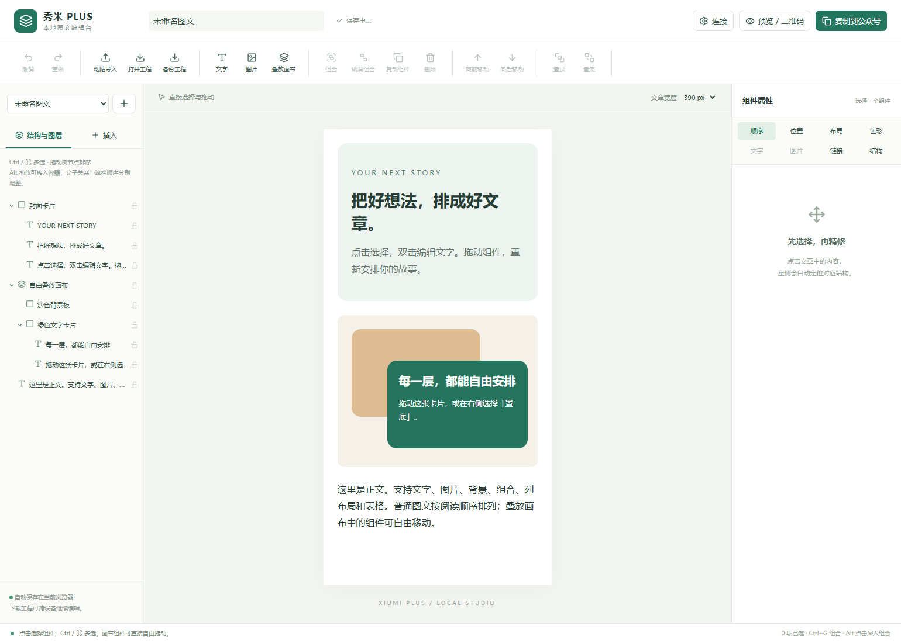
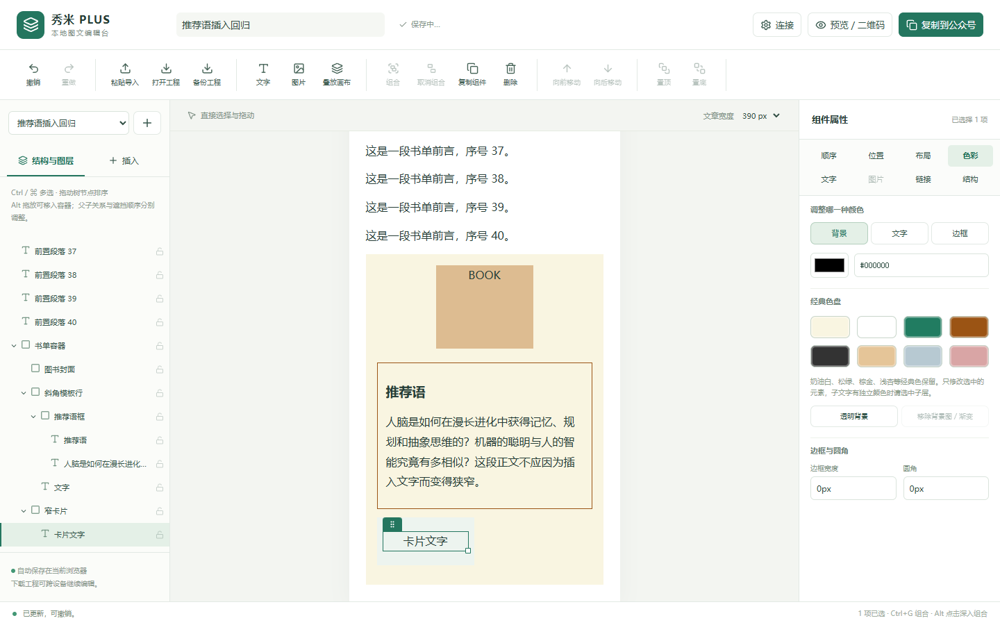
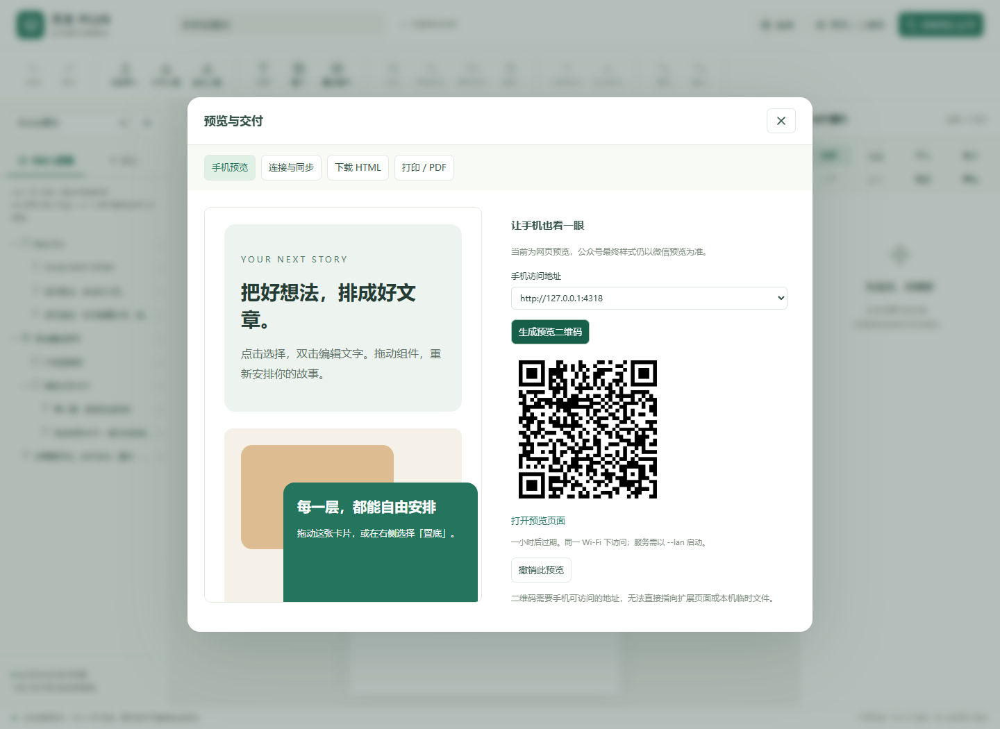

# 秀米 PLUS · 本地图文编辑台

在自己的编辑台里拖动、组合和精修图文，再交付到公众号。Chrome / Edge 扩展，MIT 开源。

> **0.4.1 实验版：已转为独立本地编辑台，不再向秀米页面注入助手。** 已实现常用文字、图片、布局、组合和图层工具，不能宣称完整复刻秀米的模板库、专属 SVG 互动和全部媒体能力。同步到真实公众号及真机显示尚待账号验证。



## 先体验这三个动作

1. [下载扩展安装包](https://github.com/Eureka-Y17/xiumi-editor-plus/releases)，解压，在 `chrome://extensions` / `edge://extensions` 开启开发者模式并加载包含 `manifest.json` 的目录。点击扩展图标 →「打开精修工作台」。
2. 首次打开就有相互遮挡的**绿色文字卡片和沙色背景板**。在左侧点「绿色文字卡片」，右侧点「置于底层」；拖动选中框上方的把手，直接改变它的位置。
3. 按 Ctrl / ⌘ 多选同级组件 →「组合」，组合后整体移动；「取消组合」恢复内部结构。双击文字进入富文本编辑。所有修改自动保存在本机。

普通图文拖动改变阅读顺序，**叠放画布内拖动改变 X / Y 坐标**。父子结构与前后遮挡分别处理，文字、图片、背景和组合都能使用图层工具；不只限于图片。

## 0.4.1 操作改进

向前/向后移动已恢复；点击正文会自动展开并定位结构树。右侧属性拆为八个分类，色彩页保留经典八色。普通插入默认放在所选文章块下方，横排模板不会被新文字挤窄；结构页另有前插/后插空行。支持 Ctrl/⌘+Z 撤销。



## 已实现的工具

- 文章直接拖拽排序、结构树拖放、Alt 拖放移入容器；Ctrl / ⌘ 多选、组合、取消组合。
- 叠放画布、自由移动、拖拽缩放、位置尺寸、六向对齐、旋转、透明度、同父层置顶 / 置底 / 逐层调整。
- 锁定、解锁、重命名、复制、删除、撤销重做；普通单列外壳拆分和内容提升。
- 段落与选区文字编辑、加粗、斜体、下划线、删除线、文字颜色、字体、字号、行高、字间距、缩进、对齐与链接。
- 本地图片插入与替换、完整显示 / 填满裁切、背景与边框调色、圆角、内外边距。
- 标题、正文、引用、列表、分隔线、卡片、列布局、表格与单元格文字编辑。
- IndexedDB 本地草稿库、自动保存、工程文件导入导出；刷新继续编辑。
- 网页预览、打印/PDF、HTML 下载、富文本复制；交付时将叠放区域及图片背景区域合成为 PNG，工程仍保持分层可编辑。

## 手机二维码与草稿同步



二维码选择**本机服务提供的临时网页**，不尝试把扩展私有地址塞进二维码。同一 Wi-Fi 可访问；链接一小时过期，也可主动撤销。这是网页排版预览，不是微信官方真机预览。

Releases 同时提供 `local-service.zip`。安装 Node.js 24+，解压服务包，Windows 双击 `start-preview.cmd`，把配对码粘贴到编辑台「连接」。首次会安装运行依赖。普通编辑完全不需要该服务。

公众号同步使用本机服务调用微信草稿接口；AppSecret 只存在服务内存，不放进扩展、工程或仓库。需要账号具备接口权限和正确的 IP 白名单。当前只**新建草稿**，不群发、不自动发布、不覆盖旧稿。未配置也能使用复制到公众号与工程备份。

秀米新草稿/原稿回写目前没有可靠接入，不提供一键回写承诺，也不绕过会员导入。可自行用官方 HTML 导入入口导入导出的 HTML，是否保留可编辑结构需实际验证。

## 安装与文档

- [详细操作手册](docs/USER_GUIDE.md)：安装、拖拽、组合、文字、图层、备份与排错。
- [本机服务与公众号连接](docs/LOCAL_SERVICE.md)：双击启动、二维码访问、接口权限与同步边界。
- [开发报告](docs/DEVELOPMENT_REPORT.md) / [测试记录](docs/TEST_REPORT.md)
- [简明开发接口](docs/INTEGRATION.md) / [贡献指南](CONTRIBUTING.md)
- [隐私说明](PRIVACY.md) / [第三方说明](THIRD_PARTY_NOTICES.md) / [更新记录](CHANGELOG.md)

## 开发

Node.js 24+：

```sh
npm ci
npm run dev
npm run typecheck
npm test
npm run build
npx playwright install chromium
npm run test:e2e
npm run zip
```

构建扩展位于 `.output/chrome-mv3`；`zip` 生成扩展及可选本机服务两个包。本机服务开发运行 `npm run bridge -- --lan`。公众号自动测试使用模拟微信响应，不使用真实账号。

独立社区项目，与秀米官方无隶属关系。示例内容均为自制。开源协议：[MIT](LICENSE)。
