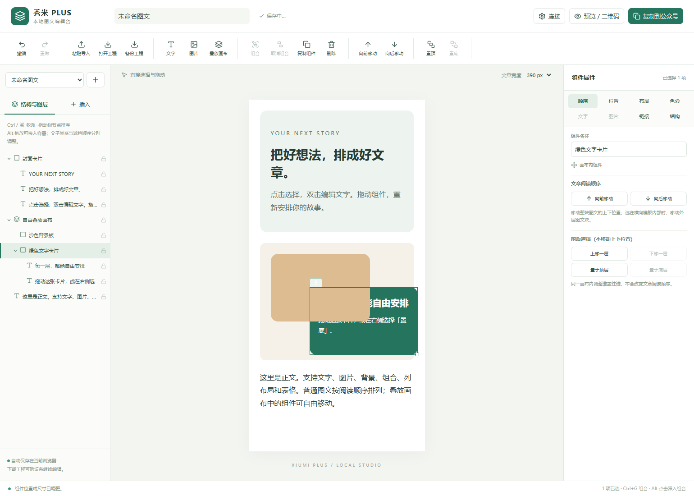

# 本地编辑台操作手册 · 0.4.1

## 1. 安装与更新

从 [Releases](https://github.com/Eureka-Y17/xiumi-editor-plus/releases) 下载 `xiumi-editor-plus-0.4.1-chrome.zip` 并解压到固定目录。Chrome 打开 `chrome://extensions`，Edge 打开 `edge://extensions`，开启开发者模式 →「加载已解压的扩展程序」，选择直接包含 `manifest.json` 的目录。

升级时先备份已有本地工程。若仍使用相同扩展安装路径，在管理页点「重新加载」，再刷新工作台；仅刷新网页不会更新扩展。更换扩展 ID、卸载、清理浏览器数据或换电脑可能导致原有草稿不可访问，跨设备请使用工程文件。

点击浏览器扩展图标 →「打开精修工作台」。本版不再在秀米页面显示结构检查助手；秀米中的既有面板刷新后消失。

## 2. 工作区与自动保存

左边为本地草稿列表、结构树及插入工具；中间为文章；右边为当前选中组件的属性；上方为常用操作栏；底部给出每次操作结果。

顶部可修改文章标题；文章宽度可以切换 375 / 390 / 450 / 600 / 750 px。点击左上角「+」新建草稿。切换草稿前会先保存当前内容。修改后等待「已保存在本机」，刷新即可继续编辑。

草稿存储于当前扩展的 IndexedDB，不上传服务器。右侧文字框的输入需点击「应用文字」才写入文章；双击编辑弹窗需点「应用并返回文章」。本地草稿不是永久备份，建议定期下载工程。

## 3. 从秀米导入或打开工程

1. 在秀米打开文章，点击「导出」，按提示 Ctrl+C（Mac：Command+C）复制完整推文。
2. 到本地编辑台点击「粘贴导入」，在粘贴框 Ctrl+V。不要使用纯文本粘贴。
3. 核对图片、标题、背景和首尾。导入结果保存为一个新的本地草稿，不覆盖秀米文章。
4. 也可通过「打开工程」选择本助手的 `.xep.json` 工程或 HTML 文件。工程文件保留组合、叠放与锁定状态，普通 HTML 不包含全部工程信息。

剪贴板已经丢失的 SVG 互动、字体或媒体不能自动恢复。远程图片仍按原地址加载，失效或防盗链图片建议替换为本地文件。

## 4. 精准选择、多选与锁定

点击文字、图片或背景即可选择；可在左侧树中找到被遮挡的组件。点击小箭头折叠子层。按住 Ctrl / ⌘（也支持 Shift）点击多选，再点击一次可取消该项。

组合默认作为整体选择。按 Alt 点击或双击内部文字，可以深入选择内部结构。树中锁形图标可锁定/解锁；锁定组件不允许拖动、编辑、删除或结构操作。右侧「名称」可以重命名，方便下次查找。

## 5. 直接拖拽与改变阅读顺序

在普通文章区域，选中组件后拖动它，或拖动绿框上方的把手。接近另一组件时显示绿色插入线，松手后放在线的位置。它改变的是上下阅读顺序，适合移动段落、图片、整张卡片。

也可以直接拖动左侧结构树的节点，默认插到目标前面。按 Alt 拖放到布局/组合节点，可移入该容器。禁止把父容器放进自身子层，禁止将表格单元格拖出表格。跨进或移出叠放画布时会说明限制，应先恢复普通布局再调整结构。

普通图文不使用任意 X/Y 位置，以免段落脱离文章流。需要自由移动时，使用下一节的叠放画布。

## 6. 像 PPT 一样的前后图层

首次打开的文章中已经有「自由叠放画布」，含沙色背景板和绿色文字卡片：

1. 左侧点击「绿色文字卡片」，右侧点「置于底层」，它会被沙色背景板遮挡；点「置于顶层」恢复。
2. 拖动所选组件上方的把手，直接改变位置。右侧 X、Y 可精确输入像素；方向键移动 1 px，Shift+方向键移动 10 px。
3. 拖动右下角小方块改变宽高，也可在属性中输入尺寸。可使用六向对齐、旋转和透明度。尺寸和间距直接填数字会按像素处理，也支持 px、% 等单位。
4. 文字、普通图片、背景板和组合容器都支持同父层的前后顺序，不局限于图片。

**父子关系**表示组件属于哪个容器，树中的缩进表达它；**前后顺序**表示同父容器中谁遮住谁，用上移一层、下移一层、置顶、置底控制。嵌套子层不能越过父层与外面的组件任意比较；先移动结构或把父组合一并调整。

上方「叠放画布」可插入新的示例画布。选中普通容器后点「转换叠放画布」，内部组件会按当前尺寸转成自由定位；「恢复普通布局」让它们回到阅读顺序，之前自由摆放的坐标不再生效。转换、拖动和层级操作均可撤销。

## 7. 合并与拆分：组合 / 取消组合

按 Ctrl / ⌘ 多选两个以上同级组件，点击「组合」（Ctrl+G）。组合在第一项的位置建立容器，保留选中项顺序及内部内容；若选了不相邻项目，它们会集中在一起，阅读顺序相应变化。之后可整体拖动、复制、删除或调整样式。

选中组合，点「取消组合」（Ctrl+Shift+G）。它移除组合壳，保留子组件。叠放组合在拆分时保留子组件的绝对位置；已旋转的组合需先恢复 0°。背景、文字、图片并不会被不可逆地糊成一张图。

普通布局的「拆分外壳」是另一项操作，会移除外壳的背景、边框与间距，执行前有确认。复杂 SVG / 互动结构不允许拆开。表格单元格不作为普通组件组合。

## 8. 文字与选区格式

双击文字，或在右侧点「直接编辑文字与选区格式」。弹窗内可以直接输入，选中部分文字后单独加粗、斜体、下划线、删除线、颜色、字号、链接或清除格式。粘贴进文字框会按纯文本插入，避免带入额外布局。点击「应用并返回文章」保存为一次可撤销操作。

右侧也可编辑整个段落内容、字体、字号、行高、字间距、首行缩进及四种对齐方式。跨格式修改后请核对预览。字体列表使用设备现有字体，不意味着读者手机一定有相同字体。

## 9. 图片、背景与布局

上方「图片」选择本地 PNG / JPEG / GIF / WebP（单张不超过 10 MB）。选中图片后可替换、设置宽高、完整显示或填满裁切，以及设置链接。导入后存储在工程内，不需要先找图床。

选中背景外壳，在右侧分别调整背景、文字与边框颜色；边框宽度、圆角、内外边距、透明度和旋转也可设置。背景图片/渐变覆盖底色时，可显式移除它。子文字若有独立颜色，应选中对应文字单独修改。

左侧「插入」提供标题、正文、引用、列表、分隔线、卡片、双列、表格与叠放画布。容器属性支持纵向、横向、双列、三列及间距。表格支持插入与单元格文字编辑；尚无表格单元格跨行跨列合并工具。

## 10. 撤销、快捷键与工程备份

上方撤销/重做，最多 40 步，切换工程或刷新后历史重建。工程正文会保存，但撤销栈不跨刷新保存。

- Ctrl / ⌘+Z：撤销；Ctrl / ⌘+Y 或 Shift+Z：重做。
- Ctrl / ⌘+G：组合；Ctrl / ⌘+Shift+G：取消组合。
- Ctrl / ⌘+D：复制组件；Delete / Backspace：删除所选组件。
- Ctrl / ⌘+S：触发本地保存；Esc：取消选择或当前拖动。
- 叠放画布中方向键：移动 1 px；Shift+方向键：10 px。

输入框与富文本编辑区内的快捷键优先作用于文字，不会误删整个组件。执行新操作会清空重做历史。下载 `.xep.json` 工程后，可在另一浏览器/电脑用「打开工程」继续编辑。

## 11. 预览、二维码与公众号交付

「预览 / 二维码」可查看独立网页预览、打印/PDF、下载 HTML。二维码和草稿同步需要可选的本机服务，详见 [本机服务说明](LOCAL_SERVICE.md)。

「复制到公众号」会将叠放画布及包含背景图片的区域在交付副本中合成为 PNG，保留外观；**本地工程仍保留分层组件**。合成区里的文字不再可单独搜索或编辑，动画会成为静态图，内部链接/互动也不能随图片保留；合成失败会明确报错，不会默默丢掉图层。普通文字段仍以富文本输出。请到公众号正文编辑器粘贴，再检查草稿与手机预览。

二维码使用兼容交付快照，是同一 Wi-Fi 下的临时网页排版预览，不是微信官方预览码。公众号同步需要 AppID、AppSecret、接口权限与出口 IP 白名单，只新建草稿不发布。真实账号兼容仍待验证。

本版不回写秀米原稿。若有秀米 HTML 导入权限，可将 HTML 导入新稿自行核对；不能保证还原秀米原生组件模型。

## 12. 故障排查

- **拖动只改变上下顺序**：当前在普通文章流；先将容器转为叠放画布，内部项目才可自由移动。
- **图层调整没有明显变化**：组件尚未实际重叠，或选中了不同父层。先用首次示例画布体验。
- **选不到组合里的文字**：Alt 点击，或从结构树展开选择；双击内部文字可编辑。
- **操作被拒绝**：检查是否锁定、跨父层、目标失效或特殊 SVG/媒体组件。底部会解释。
- **保存失败**：本机空间或浏览器数据库权限异常。先下载工程，不要关闭当前页。
- **合成图片失败**：远程图片可能不允许跨域。下载图片并替换为本地文件后再试。
- **扫码打不开**：检查服务是否带 `--lan` 启动、手机同 Wi-Fi、二维码选择的是实际局域网地址、系统防火墙是否允许该服务。127.0.0.1 只能本机访问。
- **同步失败**：查看错误编号，检查账号接口权限、IP 白名单、封面素材和图片。超时后先检查草稿箱，避免重复提交。
- **公众号与本地不同**：微信会清理部分 CSS；重叠区会转图，其他复杂模板仍需手机预览确认。

## 13. 卸载

先下载工程备份，再在扩展管理页移除扩展。停止本机服务（Ctrl+C）后，临时预览、配对码、公众号凭据及同步去重记录清空；已创建的公众号草稿不会因此删除。

## 0.4.1：分类属性、插入位置与快捷键

右侧顶部有「顺序、位置、布局、色彩、文字、图片、链接、结构」分类，点击切换。文字页再分「编辑内容」「字体与排版」。正常桌面高度无需翻阅长属性面板；较矮窗口仍保留滚动以便访问全部工具。

- **向前移动 / 向后移动**：改变文章阅读顺序，分别移到前一个块之前、后一个块之后。选中横排模板内部时整体移动横排块，避免破坏装饰布局。
- **上移一层 / 下移一层 / 置顶 / 置底**：改变同一父容器里组件相互遮挡的次序。普通没有重叠的图文没有可见效果，因此禁用；要自由叠放先在布局页转为叠放画布。
- **位置页的组件对齐**：以父容器为参照。普通窄组件可左对齐、居中、右对齐；占满整行的组件没有水平移动空间，需先减小宽度。上下对齐需要叠放画布。
- **文字页的左/中/右对齐**：改变段落内部文字排版，不移动整个组件。

点击正文会自动展开被折叠的父节点，并将左侧树滚到选中项。色彩页保留奶油白、纯白、松绿、棕金、墨灰、浅杏、雾蓝、豆沙八种经典色，可切换背景、文字和边框目标。

上方「文字」和左侧插入工具默认在所选文章块下方插入；选中嵌套文字或横排装饰模板时，会在外层完整块之后插入，防止新文字挤到左右。结构页可「前插空行」「后插空行」。要在画布里添加重叠文字，请先选择画布，在布局页点「在此画布内添加文字」。

Ctrl+Z（Mac：⌘+Z）撤销文章修改；Ctrl+Y 或 Ctrl+Shift+Z（Mac：⌘+Shift+Z）重做。在尚未应用的文字框中，这些快捷键先撤销输入；应用文字后再按会撤销文章修改。标题、导入框和富文本弹窗使用输入框自己的撤销。
