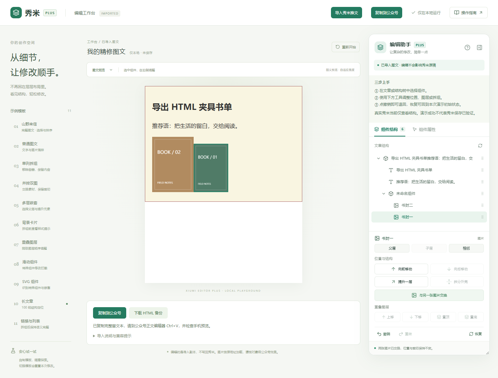
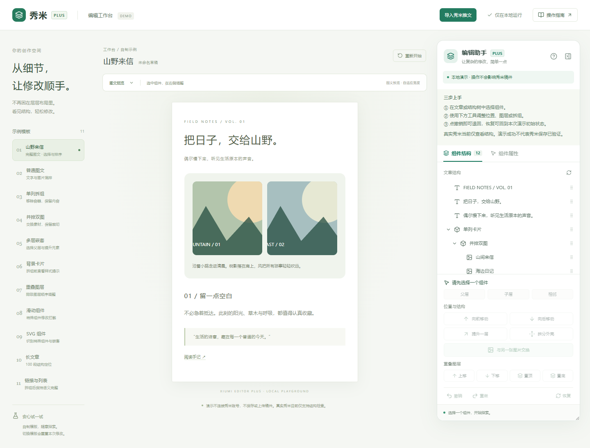
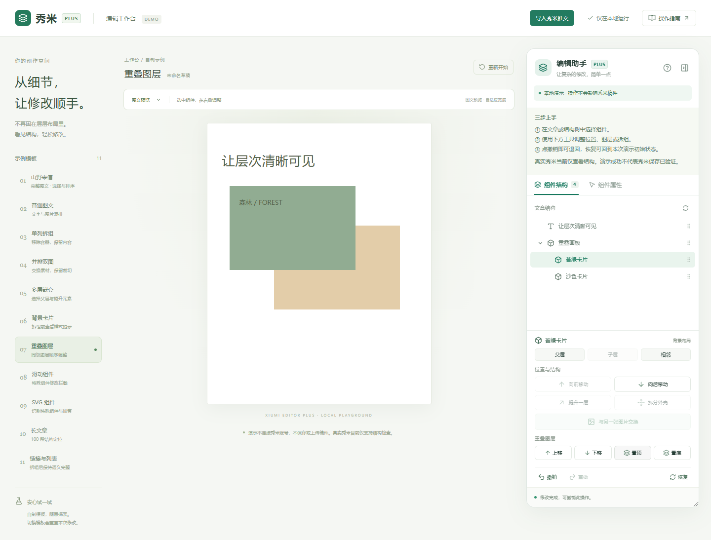

# 中文操作手册

## 1. 版本与安装

本手册适用于 0.2.0 实验版。推荐导出粘贴精修：本地编辑副本，再复制到公众号。真实秀米页面仍只读，不写回秀米原稿。

从仓库 Releases 下载 ZIP，右键解压到固定目录。Chrome 地址栏输入 `chrome://extensions`，或在 Edge 输入 `edge://extensions`，开启开发者模式，点击「加载已解压的扩展程序」，选择直接包含 `manifest.json` 的目录。不要选择 ZIP 文件本身。

安装完成后，在浏览器工具栏的扩展列表中固定「秀米编辑增强助手」。点击图标，打开精修工作台。如果当前在秀米，会打开检查面板，再点「导入推文精修」。如果从源码构建，选择 `.output/chrome-mv3`。

## 推荐：导入真实秀米图文精修

1. 在秀米打开推文，点击顶部「导出」，按页面提示复制整篇图文（Ctrl+C，Mac 为 Command+C）。不要只选中某段推荐语。
2. 在助手点击「导入推文精修」；若已打开工作台，点右上角「导入秀米推文」。
3. 点击弹窗粘贴区域，Ctrl+V。必须是富文本；若使用了纯文本粘贴，会得到重新复制的提示。
4. 核对推文首尾、图片、背景和边框。树中选择元素，可交换普通图片素材、调整同级顺序、拆分可识别的普通单列外壳，以及撤销恢复。复杂结构的按钮会禁用。
5. 完成后点击「复制到公众号」，到公众号正文编辑器 Ctrl+V。保存为草稿，在手机预览后再发布。助手不会自动发布文章。
6. 点击「下载 HTML 备份」保存本地副本。刷新、切换模板或关闭页面前请先备份；导入新文章也会替换当前工作台内容。

此流程编辑的是发布用 HTML，不是秀米原生工程。剪贴板已经丢失的 SVG 互动或特殊字体不能自动恢复；普通字体遵循读者设备环境。预览加载原图片地址，防盗链、过期链接和公众号图片规则仍需实际检查。剪贴板写入被浏览器阻止时可先下载 HTML 备份。

普通导入无需安装或关联官方「秀米插件」。官方插件主要处理秀米到公众号的格式传输，不能据此推断它能接收本助手的修改结果。相关结论见开发报告。

## 2. 认识工作台

左侧选择模板，中间是自制文章，右侧是编辑助手。切换模板或点「重新开始」会丢弃当前演示修改。演示不自动保存，关闭或刷新页面也会重置。

面板可拖动右边缘调宽；较窄窗口下浏览器原生缩放可帮助查看。点击面板右上角收起按钮，再点击「打开编辑助手」恢复。

右上角问号提供简短入门；「组件属性」可查看当前选中组件的类型、标签、子组件数量、屏幕尺寸和内联图层值。

## 3. 选择与查找组件

点击文章中的标题、图片或卡片，结构树将选中对应节点。点击结构树节点，文章自动滚动并用绿色轮廓标记元素。轮廓是浮层，不写入正文。

点击小箭头展开或折叠布局。选不到被遮挡的元素时，直接在树里找它，或使用「父层」「子层」「相邻」按钮。相邻按钮在同一父层的节点之间循环。

## 4. 图片交换

选择「并排双图」模板，在树中选「山间来信」，点击「与另一张图片交换」，再选「海边日记」。图片素材、响应式素材信息和替代文字交换，图片位置的宽高、裁切、圆角及外层链接保留。再次点击交换按钮可取消；选错组件会得到说明。

该功能不移动整个图片容器。背景图及合成图内部的元素不能按普通图片交换处理。

## 5. 调整顺序、拆组和提升

「向前移动 / 向后移动」修改同一容器内的组件顺序，也可以拖动结构树节点到同级节点。向后拖到目标后方，向前拖到目标前方。跨容器拖动会被拒绝。

选择「单列拆组」中的单列卡片，点「拆分外壳」。确认框会说明外壳样式损失。确认后保留内部文字、图片、列表和链接，移除外壳；「背景卡片」可体验背景、边框、间距的损失提示。特殊组件和未标记的布局不能拆组。

在「多层嵌套」中选择内部文字，点「提升一层」，它会被移动到原父容器后方，父容器保留。父容器必须是演示中明确标记的普通单列布局。

## 6. 重叠图层

选择「重叠图层」，在结构树中选择「苔绿卡片」，点击「置顶」；也可逐层上移、下移或置底。该功能调整遮挡次序，不改变文章上下阅读顺序。只对明确标记、同父容器的重叠元素开放。

## 7. 撤销、重做、恢复

「撤销」回退助手最近一次修改，「重做」重新执行。最多保存最近 40 个操作；执行新操作会清空重做历史。「恢复」回到当前模板载入时的内容，恢复本身也可撤销。

历史只对本地演示有效。检测到其他脚本或手动方式改动正文时，拒绝继续覆盖；重新开始演示即可解除。与秀米原生撤销系统的联动尚未实现。

## 8. 在真实秀米中使用

安装后刷新秀米网页，进入图文编辑页，点击浏览器扩展图标即可直接打开助手；也可使用页面上的「秀米 Plus · 查看结构」按钮。无需填写任何接口参数。此时顶部应显示「结构检查模式 · 修改尚未验证」。移动、交换、拆组、图层和恢复操作均禁用。

只读识别使用页面上可见的 `contenteditable` 区域启发式查找，不保证当前秀米版本一定匹配，也不代表内部文档结构。iframe 编辑器暂不支持。**本版没有已验证的真实秀米编辑能力。**

如果仅出现「推荐语」与一段正文，说明可能只选到了局部文字框。新版会向外查找包含其他图片、书卡的候选区域，但仍需要核对。点「点选文章范围」后将鼠标移到推文卡片，绿色边框标示候选，单击确认；Esc 取消。用「扩大一层」逐层包含更多内容，「重新识别」重新查找。不需要填写 CSS 选择器。要编辑完整推文，请使用导出粘贴精修。

## 9. 字体说明

首版不增加字体。电脑上能显示某种字体不意味着读者手机安装了它，回退字体可能改变字宽与行高。标题转图片能固定外观，但会失去直接选择、搜索和编辑文字的能力；同时需要确认字体使用许可。

## 10. 故障排查

- **找不到扩展**：确认加载的是含 `manifest.json` 的目录，检查扩展管理页是否有报错。
- **秀米中没有入口**：刷新 HTTPS 秀米页面；检查扩展的站点访问是否允许。其他域名和本地文件不会自动注入。
- **未找到图文区域**：进入图文编辑页再试；当前版本可能采用不同结构或 iframe，请提交脱敏后的版本与复现步骤。
- **按钮灰色**：先选中适合的节点；悬停按钮查看原因。真实秀米中的修改按钮全部禁用。
- **点击图片没有交换**：先点交换，再选另一张普通图片；不要选外壳、同一图片或特殊组件内部图片。
- **刷新后修改丢失**：演示不持久化，这是当前设计。真实秀米保存未验证，不要尝试用开发者工具强行解除限制。
- **公众号显示与演示不同**：演示不是微信渲染器，不能作为公众号兼容证明；需要真实草稿和手机预览验证。

## 11. 更新与卸载

升级前下载并解压新包，在扩展管理页重新加载对应目录；路径改变时先移除旧扩展再加载新目录。关闭演示前自行记录需要保留的操作。卸载在扩展管理页点击「移除」，并刷新已打开的秀米标签页。
